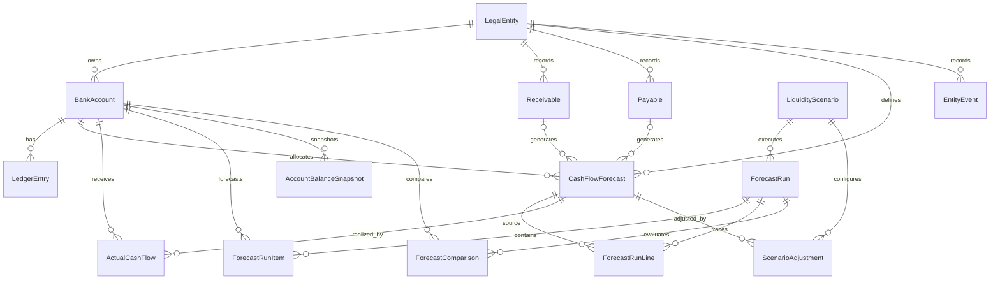

# Entity Relationship Diagram

The following Mermaid diagram summarizes the main business relationships. The Prisma schema is authoritative for exact optionality and constraints.

## Relationship notes
- A legal entity can own multiple bank accounts.
- A bank account can have multiple ledger entries and actual cash flows.
- A forecast run belongs to one liquidity scenario.
- A forecast run contains daily account-level items and source-level forecast lines.
- A forecast flow can optionally reference a bank account, receivable or payable.
- Actual cash flows may link to a source forecast.
- CurrencyRate is an effective-dated currency pair lookup.
- AuditEvent uses aggregate type and aggregate ID fields for generic audit references.
